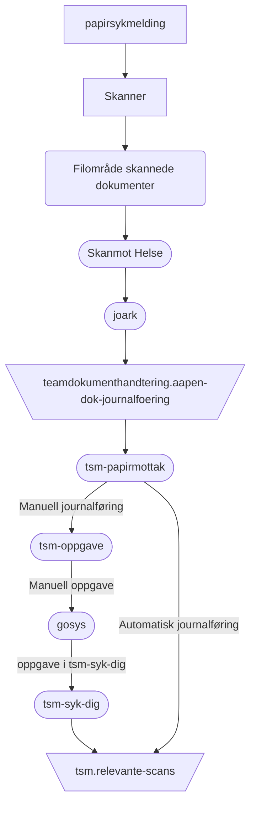

# tsm-papirmottak
Application for handling papirsykmeldinger


## FlowChart
This the high level flow of the application


## Requirements for developing the application
#### Java
Make sure you have the Java JDK 25 installed
You can check which version you have installed using this command:
``` bash
java -version
```
or install it: https://sdkman.io/

#### Docker
Make sure you have docker installed using this command:
You can check which version you have installed using this command:
``` bash
docker --version
```
or install it: https://docs.docker.com/engine/install/

#### Docker Compose
Make sure you have docker compose installed using this command:
You can check which version you have installed using this command:
``` bash
docker compose version
```
or install it: https://docs.docker.com/compose/install/


### Building the application
To build the application locally and run tests you can simply run
``` bash
./gradlew clean build
 ```

### Running the application locally
Run in development to enable hot reloading and stubbed external dependencies:

#### With Gradle and Docker Compose

``` bash
./gradlew runLocal
```

#### With IntelliJ

In IntelliJ go to the run the main function,
then "Modify Run configuration..."
then add `-Dio.ktor.development=true -config=application-local.conf` to the "Program arguments".

#### Kafka message
The topic `teamdokumenthandtering.aapen-dok-journalfoering` uses Confluent Avro, not
plain JSON. Use `KafkaAvroSerializer` with `JournalfoeringHendelseRecord` and the
local schema registry at `http://localhost:8081`, started by Docker Compose.

The integration test publishes an Avro record and a tombstone to an isolated Kafka
container, using an in-memory schema registry, and waits for the consumer to commit both:
```bash
./gradlew test --tests no.nav.tsm.IntegrationTest
```

In NAIS, schema registry configuration comes from `KAFKA_SCHEMA_REGISTRY`,
`KAFKA_SCHEMA_REGISTRY_USER`, and `KAFKA_SCHEMA_REGISTRY_PASSWORD`.

### Finding new available dependencies
``` bash
./gradlew dependencyUpdates
```

### Upgrading the Gradle wrapper version to latest
``` bash
./gradlew :wrapper --gradle-version latest
```

## Contributing

To get started, fork the repository and create a new branch.

See details in [CONTRIBUTING.md](CONTRIBUTING.md)

### Contact

This project is maintained by [navikt/tsm](CODEOWNERS)

Questions and/or feature requests? Please create an [issue](https://github.com/navikt/tsm-papirmottak/issues)

If you work in [@navikt](https://github.com/navikt) you can reach us at the Slack
channel [#team-symfoni](https://nav-it.slack.com/archives/C07MY3KCDS5)